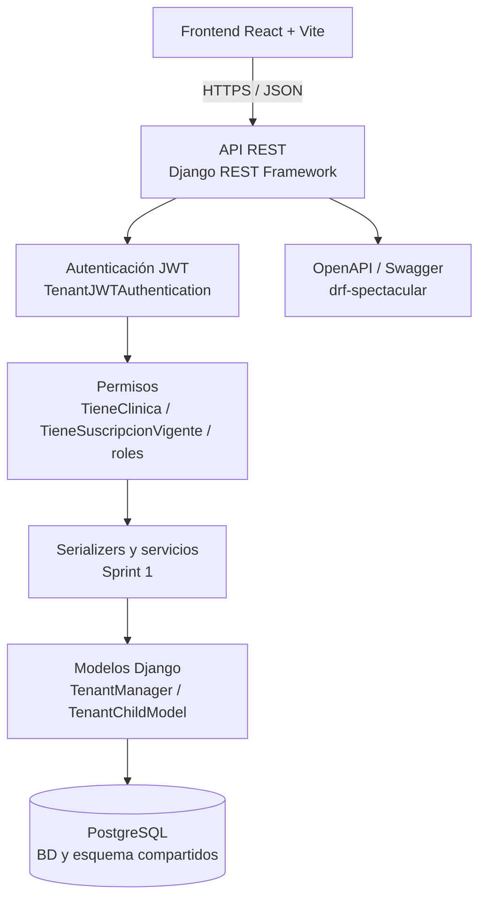
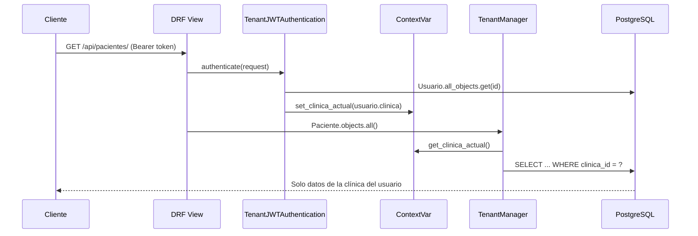

# Arquitectura del SaaS Multitenant de Clínicas

**Sprints 0 y 1 · Fundamentos backend y API de negocio**

## 1. Stack tecnológico

| Capa | Tecnología |
|---|---|
| Frontend | React + Vite (fuera del alcance de los Sprints 0 y 1) |
| API | Django 5.2 LTS + Django REST Framework 3.16 |
| Autenticación | JWT (`djangorestframework-simplejwt`) |
| Base de datos | PostgreSQL 17 |
| Documentación API | `drf-spectacular` (OpenAPI 3 + Swagger UI) |
| CORS | `django-cors-headers` |
| Configuración | `python-decouple` + `backend/.env` |
| Pruebas | `pytest` + `pytest-django` |
| CI | GitHub Actions + servicio PostgreSQL |

## 2. Arquitectura en capas



La API es stateless: el cliente envía el JWT en `Authorization: Bearer <token>`.
Cada petición resuelve la clínica del usuario y la fija en un `ContextVar` antes de
tocar los modelos. El Sprint 0 entregó modelos, migraciones, aislamiento, semilla y
pruebas; el Sprint 1 construyó sobre esa base la autenticación, los recursos de
negocio, las reglas de suscripción y la documentación OpenAPI.

## 3. Estrategia multitenant

### Decisión: base de datos y esquema compartidos con columna `clinica_id`

Todos los tenants comparten la misma base de datos y el mismo esquema. Las entidades
raíz de cada clínica llevan una FK directa `clinica_id`; las entidades hijas heredan
la clínica de su padre mediante una ruta de lookup (`tenant_lookup`).

| Tipo de entidad | Ejemplo | Aislamiento |
|---|---|---|
| Raíz | `Paciente`, `Personal`, `Rol`, `Cita`, `Ambulancia` | FK directa `clinica_id` |
| Hija | `HistoriaClinica`, `Enfermedad`, `Receta`, `Equipamiento` | `tenant_lookup`: `paciente__clinica`, `consulta__clinica`, etc. |
| Global | `Clinica`, `PlanSuscripcion`, tablas `auth_*` | Sin filtro tenant |

### Componentes implementados

1. **Modelos abstractos** (`apps/core/managers.py`):
   - `TenantModel`: entidades raíz con `clinica_id` y dos managers.
   - `TenantChildModel`: entidades hijas que declaran `tenant_lookup`.
2. **`TenantManager` y `TenantQuerySet`**:
   - `objects`: filtra automáticamente por la clínica activa.
   - `all_objects`: acceso sin filtro, reservado a autenticación, admin de plataforma,
     comandos de gestión y pruebas explícitas.
   - Si no hay contexto, `objects` **falla cerrado** con `TenantNoConfigurado`.
   - **Excepción documentada:** `Usuario` no sigue este patrón; ver la regla
     específica más abajo.
3. **Contexto de petición** (`apps/core/tenant.py`):
   - `contextvars.ContextVar` (seguro también en código asíncrono).
   - `tenant_context(clinica)` para servicios, comandos y pruebas.
   - `contexto_limpio()` aísla cada petición con tokens de `ContextVar` y restaura el
     estado en `finally`, incluso si la vista lanza una excepción.
   - `set_bypass()` para el administrador del sistema.
4. **Resolución de la clínica**:
   - `TenantMiddleware`: sesiones y admin de Django (después de
     `AuthenticationMiddleware`).
   - `TenantJWTAuthentication`: autenticación DRF. Lee el usuario desde la BD
     (no confía en un claim de clínica del token) y fija su clínica o activa el
     bypass si es superusuario sin clínica.
5. **Escritura segura**:
   - En modelos raíz, si no se envía `clinica`, se toma del contexto.
   - Si se intenta guardar un registro de otra clínica, se lanza `ClinicaAjena`.
   - `TenantViewSetMixin` (Sprint 1) asignará `clinica=request.user.clinica` y nunca
     aceptará la clínica desde el body.
6. **Administrador del sistema**:
   - `Usuario.clinica` es nullable solo para superusuarios (restricción
     `usuario_clinica_o_superuser`).
   - En el admin de plataforma se usa `all_objects` para inspeccionar todos los
     tenants. Los endpoints de negocio rechazan usuarios sin clínica.

#### Regla especial para `Usuario`

`Usuario.objects` es el `_default_manager` y **es global a propósito**: Django lo usa
en `ModelBackend.authenticate()` y `ModelBackend.get_user()` antes de que exista
contexto de clínica. Filtrarlo por clínica rompe el login y la carga de la sesión con
`TenantNoConfigurado`.

| Manager | Filtro | Uso permitido |
|---|---|---|
| `Usuario.objects` | **No** | Solo autenticación de Django, sesiones y `createsuperuser`. |
| `Usuario.tenant_objects` | Sí, fail-closed | **Obligatorio** en endpoints, serializers, formularios y servicios tenant. |
| `Usuario.all_objects` | No | Admin de plataforma, autenticación JWT, comandos y pruebas explícitas. |

Regla de implementación: todo endpoint, serializer, `ModelChoiceField` o formulario
que exponga usuarios dentro de una clínica debe declarar explícitamente
`queryset=Usuario.tenant_objects`. No se debe usar `Usuario.objects` para lógica de
negocio multiinquilino.

### Flujo de una petición JWT



### Justificación frente a una BD por clínica

| Criterio | BD/esquema compartido | BD por clínica |
|---|---|---|
| Costo operativo | Bajo: una sola BD y un solo `migrate` | Alto: N BDs, N migraciones, N backups |
| Escalabilidad inicial | Suficiente para decenas de clínicas | Mejor aislamiento físico, más complejidad |
| Consultas cross-tenant | Sencillas para administración de plataforma | Requieren agregación externa |
| Riesgo principal | Fuga por filtro mal aplicado | Sobrecosto y deriva de esquemas |
| Mitigación | Manager fail-closed + pruebas de aislamiento | Automatización de aprovisionamiento |

Para el alcance del proyecto (SaaS de clínicas pequeñas y medianas), la BD compartida
con `clinica_id` y un manager que falla cerrado ofrece el mejor equilibrio entre
seguridad, simplicidad y costo. Una BD por clínica se reevaluará solo si un requisito
legal o de escala lo exige.

## 4. Estructura de apps

```
backend/
├── config/          # settings, urls, wsgi/asgi
├── apps/
│   ├── core/        # abstractos, tenant, managers, auth, middleware, semilla
│   ├── clinicas/    # Clinica, PlanSuscripcion, Suscripcion
│   ├── seguridad/   # Usuario, Rol, UsuarioRol
│   ├── personal/    # Personal, Especialidad, Medico, HorarioAtencion
│   ├── pacientes/   # Paciente, HistoriaClinica, Enfermedad, Alergia
│   ├── atencion/    # Cita, Consulta, Receta, MedicamentoRecetado
│   └── ambulancias/# Ambulancia, Equipamiento, LicenciaConducir, Traslado
└── tests/           # modelos, aislamiento, semilla y configuración
```

## 5. Configuración por entorno

- `backend/.env` contiene todos los secretos y valores por entorno. Está ignorado por Git.
- `backend/.env.example` documenta las variables sin valores reales.
- `SECRET_KEY`, `DB_NAME`, `DB_USER`, `DB_PASSWORD`, `DB_HOST` y `DB_PORT` son
  obligatorias: `settings.py` falla con `ImproperlyConfigured` y un mensaje claro si faltan.
- `config/settings_test.py` hereda la configuración y usa un hasher rápido solo en pruebas.
- En CI las variables se inyectan desde el workflow con valores de prueba.

## 6. Flujo de trabajo implementado en el Sprint 1

1. Los viewsets tenant obtienen su queryset con `queryset_tenant(Modelo, request)`,
   que usa el manager tenant y devuelve vacío durante la generación de OpenAPI.
2. Para `Usuario` se usa `Usuario.tenant_objects`; para autenticación JWT se usa
   `Usuario.all_objects` de forma explícita.
3. En creación/actualización, la clínica se toma de `request.user.clinica`; los
   serializers la declaran `read_only` y nunca la aceptan desde el body.
4. Las relaciones a usuarios, roles, personal, especialidades y médicos usan
   `TenantRelatedField`, que resuelve el queryset por petición y falla cerrado.
5. Para operaciones de plataforma (superusuario sin clínica) se usa `all_objects`
   de forma explícita y auditada.
6. Toda consulta nueva debe cubrirse con una prueba de aislamiento entre dos clínicas.

## 7. API del Sprint 1

Base: `/api/v1/`. Documentación interactiva: `/api/docs/` (botón **Authorize** con
Bearer JWT). Esquema OpenAPI: `/api/schema/`.

### 7.1 Autenticación

| Método | Ruta | Descripción |
|---|---|---|
| POST | `/auth/login/` | Devuelve `access`, `refresh`, `acceso_restringido` y perfil. |
| POST | `/auth/refresh/` | Rota el refresh token y devuelve un nuevo par. |
| POST | `/auth/logout/` | Invalida el refresh en la blacklist de SimpleJWT. |
| GET | `/auth/me/` | Perfil, roles y estado de suscripción del usuario. |
| POST | `/auth/cambiar-password/` | Cambio de contraseña del propio usuario. |

El login de un Administrador de clínica sin suscripción vigente se permite en
**modo restringido**: solo puede acceder a `/auth/me/`, `GET /planes/` y a sus
endpoints de suscripción. La lectura de clínicas y cualquier otro endpoint de
negocio responde `403` con código `suscripcion_vencida`. Los demás roles sin
suscripción reciben el mismo `403` desde el login.

### 7.2 Recursos

| Recurso | Rutas | Escritura |
|---|---|---|
| Clínicas | `/clinicas/` | Solo administrador del sistema. |
| Planes | `/planes/` | Escritura solo administrador del sistema. |
| Suscripciones | `/suscripciones/`, `/{id}/renovar/`, `/{id}/cambiar-plan/`, `/{id}/cancelar/` | Administrador de clínica. |
| Usuarios | `/usuarios/` | Administrador de clínica. |
| Roles | `/roles/` | Administrador de clínica; roles base protegidos. |
| Asignaciones | `/usuario-roles/` | Administrador de clínica. |
| Personal | `/personal/`, `/{id}/vincular-usuario/` | Administrador de clínica. |
| Especialidades | `/especialidades/` | Lectura admin/médico; escritura admin. |
| Médicos | `/medicos/` | Administrador de clínica. |
| Horarios | `/horarios/` | Admin o médico (el médico solo sobre su propio registro). |

### 7.3 Reglas de suscripción y límites

- La vigencia se calcula al vuelo: `estado=ACTIVA` y
  `fecha_inicio <= hoy <= fecha_fin`.
- Al contratar o renovar se marcan oportunistamente como `VENCIDA` las
  suscripciones activas cuya fecha de fin ya pasó.
- Solo puede existir una suscripción `ACTIVA` por clínica.
- `max_usuarios` cuenta usuarios con `estado=True`.
- La creación y la reactivación de usuarios usan `select_for_update` sobre la
  clínica y `_asegurar_cupo`; en concurrencia, exactamente una petición obtiene
  `201` y la otra `409 limite_usuarios`.
- El primer administrador creado al registrar una clínica es un bootstrap: no
  valida suscripción ni `max_usuarios`.
- La clínica debe conservar al menos un Administrador de clínica activo.
- Los roles base no se renombran, desactivan ni eliminan; su descripción sí es
  editable.

### 7.4 Formato de errores

Todas las respuestas de error usan:

```json
{
  "codigo": "suscripcion_vencida",
  "mensaje": "La clínica no tiene una suscripción vigente.",
  "detalles": {}
}
```

`detalles` es opcional y se usa en errores de validación o de límites.

### 7.5 Códigos de error de negocio

| Código | HTTP | Significado |
|---|---|---|
| `credenciales_invalidas` | 401 | Usuario o contraseña incorrectos. |
| `no_autenticado` | 401 | Token ausente, inválido o usuario inactivo. |
| `permiso_denegado` | 403 | El rol no permite la operación. |
| `suscripcion_vencida` | 403 | La clínica no tiene suscripción vigente. |
| `clinica_inactiva` | 403 | La clínica está desactivada. |
| `sin_clinica` | 403 | Usuario no superusuario sin clínica. |
| `medico_no_vinculado` | 403 | Médico sin registro de Personal/Médico. |
| `datos_invalidos` | 400 | Error de validación de campos. |
| `password_invalida` | 400 | La contraseña no cumple los validadores de Django. |
| `password_actual_invalida` | 400 | La contraseña actual no coincide. |
| `password_repetida` | 400 | La nueva contraseña es igual a la actual. |
| `refresh_invalido` | 401 | Refresh token inválido, expirado o en blacklist. |
| `nit_duplicado` | 409 | Ya existe una clínica con ese NIT. |
| `usuario_duplicado` | 409 | Username no disponible. |
| `email_duplicado` | 409 | Email no disponible. |
| `clinica_duplicada` | 409 | Conflicto de unicidad al provisionar la clínica. |
| `limite_usuarios` | 409 | Se alcanzó `max_usuarios` del plan. |
| `plan_inactivo` | 409 | El plan seleccionado no está activo. |
| `suscripcion_activa` | 409 | La clínica ya tiene una suscripción activa. |
| `suscripcion_no_vigente` | 409 | No se puede renovar una suscripción no vigente. |
| `suscripcion_no_activa` | 409 | No se puede cancelar una suscripción no activa. |
| `fechas_invalidas` | 400 | Fecha de fin anterior a la de inicio. |
| `fecha_fin_invalida` | 400 | La nueva fecha de fin no extiende la actual. |
| `ultimo_administrador` | 409 | Se intenta dejar la clínica sin admin activo. |
| `rol_base_protegido` | 409 | Intento de renombrar, desactivar o borrar un rol base. |
| `rol_duplicado` | 409 | Ya existe un rol con ese nombre. |
| `rol_con_asignaciones` | 409 | El rol tiene asignaciones. |
| `rol_ya_asignado` | 409 | El usuario ya tiene ese rol. |
| `rol_ajeno` | 409 | El rol pertenece a otra clínica. |
| `rol_inactivo` | 409 | El rol está inactivo. |
| `ci_duplicada` | 409 | CI duplicada en la clínica. |
| `personal_ya_es_medico` | 409 | El personal ya tiene médico asociado. |
| `colegiatura_duplicada` | 409 | Número de colegiatura ya registrado. |
| `especialidad_duplicada` | 409 | Especialidad duplicada en la clínica. |
| `especialidad_en_uso` | 409 | La especialidad tiene médicos asociados. |
| `horario_solapado` | 409 | El horario se solapa con otro del médico. |
| `horario_invalido` | 400 | Hora de inicio mayor o igual a la de fin. |
| `medico_requerido` | 400 | Falta el médico al crear un horario como admin. |
| `personal_con_medico` | 409 | No se puede borrar personal con médico. |
| `usuario_ya_vinculado` | 409 | El usuario ya está vinculado a otro personal. |
| `no_encontrado` | 404 | El recurso no existe o es de otra clínica. |
| `demasiados_intentos` | 429 | Throttling del login. |

Estos códigos se muestran también en la descripción global de Swagger y en las
respuestas documentadas de cada endpoint.
