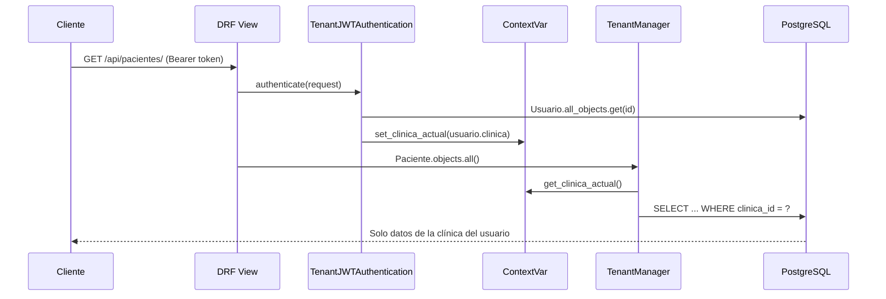

# Arquitectura del SaaS Multitenant de Clínicas

**Sprint 0 · Fundamentos backend**

## 1. Stack tecnológico

| Capa | Tecnología |
|---|---|
| Frontend | React + Vite (fuera del alcance del Sprint 0) |
| API | Django 5.2 LTS + Django REST Framework 3.16 |
| Autenticación | JWT (`djangorestframework-simplejwt`) |
| Base de datos | PostgreSQL 17 |
| Documentación API | `drf-spectacular` (OpenAPI 3 + Swagger UI) |
| CORS | `django-cors-headers` |
| Configuración | `python-decouple` + `backend/.env` |
| Pruebas | `pytest` + `pytest-django` |
| CI | GitHub Actions + servicio PostgreSQL |

## 2. Arquitectura en capas


La API es stateless: el cliente envía el JWT en `Authorization: Bearer <token>`.
Cada petición resuelve la clínica del usuario y la fija en un `ContextVar` antes de
tocar los modelos. Los endpoints de negocio se construirán en el Sprint 1 sobre esta
base; el Sprint 0 solo entrega modelos, migraciones, aislamiento, semilla y pruebas.

## 3. Estrategia multitenant

### Decisión: base de datos y esquema compartidos con columna `clinica_id`

Todos los tenants comparten la misma base de datos y el mismo esquema. Las entidades
raíz de cada clínica llevan una FK directa `clinica_id`; las entidades hijas heredan
la clínica de su padre mediante una ruta de lookup (`tenant_lookup`).

| Tipo de entidad | Ejemplo | Aislamiento |
|---|---|---|
| Raíz | `Paciente`, `Personal`, `Rol`, `Cita`, `Ambulancia` | FK directa `clinica_id` |
| Hija | `HistoriaClinica`, `Enfermedad`, `Receta`, `Equipamiento` | `tenant_lookup`: `paciente__clinica`, `consulta__clinica`, etc. |
| Global | `Clinica`, `PlanSuscripcion`, tablas `auth_*` | Sin filtro tenant |

### Componentes implementados

1. **Modelos abstractos** (`apps/core/managers.py`):
   - `TenantModel`: entidades raíz con `clinica_id` y dos managers.
   - `TenantChildModel`: entidades hijas que declaran `tenant_lookup`.
2. **`TenantManager` y `TenantQuerySet`**:
   - `objects`: filtra automáticamente por la clínica activa.
   - `all_objects`: acceso sin filtro, reservado a autenticación, admin de plataforma,
     comandos de gestión y pruebas explícitas.
   - Si no hay contexto, `objects` **falla cerrado** con `TenantNoConfigurado`.
   - **Excepción documentada:** `Usuario` no sigue este patrón; ver la regla
     específica más abajo.
3. **Contexto de petición** (`apps/core/tenant.py`):
   - `contextvars.ContextVar` (seguro también en código asíncrono).
   - `tenant_context(clinica)` para servicios, comandos y pruebas.
   - `contexto_limpio()` aísla cada petición con tokens de `ContextVar` y restaura el
     estado en `finally`, incluso si la vista lanza una excepción.
   - `set_bypass()` para el administrador del sistema.
4. **Resolución de la clínica**:
   - `TenantMiddleware`: sesiones y admin de Django (después de
     `AuthenticationMiddleware`).
   - `TenantJWTAuthentication`: autenticación DRF. Lee el usuario desde la BD
     (no confía en un claim de clínica del token) y fija su clínica o activa el
     bypass si es superusuario sin clínica.
5. **Escritura segura**:
   - En modelos raíz, si no se envía `clinica`, se toma del contexto.
   - Si se intenta guardar un registro de otra clínica, se lanza `ClinicaAjena`.
   - `TenantViewSetMixin` (Sprint 1) asignará `clinica=request.user.clinica` y nunca
     aceptará la clínica desde el body.
6. **Administrador del sistema**:
   - `Usuario.clinica` es nullable solo para superusuarios (restricción
     `usuario_clinica_o_superuser`).
   - En el admin de plataforma se usa `all_objects` para inspeccionar todos los
     tenants. Los endpoints de negocio rechazan usuarios sin clínica.

#### Regla especial para `Usuario`

`Usuario.objects` es el `_default_manager` y **es global a propósito**: Django lo usa
en `ModelBackend.authenticate()` y `ModelBackend.get_user()` antes de que exista
contexto de clínica. Filtrarlo por clínica rompe el login y la carga de la sesión con
`TenantNoConfigurado`.

| Manager | Filtro | Uso permitido |
|---|---|---|
| `Usuario.objects` | **No** | Solo autenticación de Django, sesiones y `createsuperuser`. |
| `Usuario.tenant_objects` | Sí, fail-closed | **Obligatorio** en endpoints, serializers, formularios y servicios tenant. |
| `Usuario.all_objects` | No | Admin de plataforma, autenticación JWT, comandos y pruebas explícitas. |

Regla de implementación: todo endpoint, serializer, `ModelChoiceField` o formulario
que exponga usuarios dentro de una clínica debe declarar explícitamente
`queryset=Usuario.tenant_objects`. No se debe usar `Usuario.objects` para lógica de
negocio multiinquilino.

### Flujo de una petición JWT



### Justificación frente a una BD por clínica

| Criterio | BD/esquema compartido | BD por clínica |
|---|---|---|
| Costo operativo | Bajo: una sola BD y un solo `migrate` | Alto: N BDs, N migraciones, N backups |
| Escalabilidad inicial | Suficiente para decenas de clínicas | Mejor aislamiento físico, más complejidad |
| Consultas cross-tenant | Sencillas para administración de plataforma | Requieren agregación externa |
| Riesgo principal | Fuga por filtro mal aplicado | Sobrecosto y deriva de esquemas |
| Mitigación | Manager fail-closed + pruebas de aislamiento | Automatización de aprovisionamiento |

Para el alcance del proyecto (SaaS de clínicas pequeñas y medianas), la BD compartida
con `clinica_id` y un manager que falla cerrado ofrece el mejor equilibrio entre
seguridad, simplicidad y costo. Una BD por clínica se reevaluará solo si un requisito
legal o de escala lo exige.

## 4. Estructura de apps

```
backend/
├── config/          # settings, urls, wsgi/asgi
├── apps/
│   ├── core/        # abstractos, tenant, managers, auth, middleware, semilla
│   ├── clinicas/    # Clinica, PlanSuscripcion, Suscripcion
│   ├── seguridad/   # Usuario, Rol, UsuarioRol
│   ├── personal/    # Personal, Especialidad, Medico, HorarioAtencion
│   ├── pacientes/   # Paciente, HistoriaClinica, Enfermedad, Alergia
│   ├── atencion/    # Cita, Consulta, Receta, MedicamentoRecetado
│   └── ambulancias/# Ambulancia, Equipamiento, LicenciaConducir, Traslado
└── tests/           # modelos, aislamiento, semilla y configuración
```

## 5. Configuración por entorno

- `backend/.env` contiene todos los secretos y valores por entorno. Está ignorado por Git.
- `backend/.env.example` documenta las variables sin valores reales.
- `SECRET_KEY`, `DB_NAME`, `DB_USER`, `DB_PASSWORD`, `DB_HOST` y `DB_PORT` son
  obligatorias: `settings.py` falla con `ImproperlyConfigured` y un mensaje claro si faltan.
- `config/settings_test.py` hereda la configuración y usa un hasher rápido solo en pruebas.
- En CI las variables se inyectan desde el workflow con valores de prueba.

## 6. Flujo de trabajo para los Sprints 1 y 2

1. Los viewsets tenant heredan de `TenantViewSetMixin`.
2. El queryset se obtiene de `Model.objects` (ya filtrado por clínica). Para
   `Usuario` la excepción es obligatoria: `Usuario.tenant_objects`.
3. En creación, la clínica se toma de `request.user.clinica`; nunca del payload.
4. Para operaciones de plataforma (superusuario sin clínica) se usa `all_objects`
   de forma explícita y auditada.
5. Toda consulta nueva debe cubrirse con una prueba de aislamiento entre dos clínicas.
