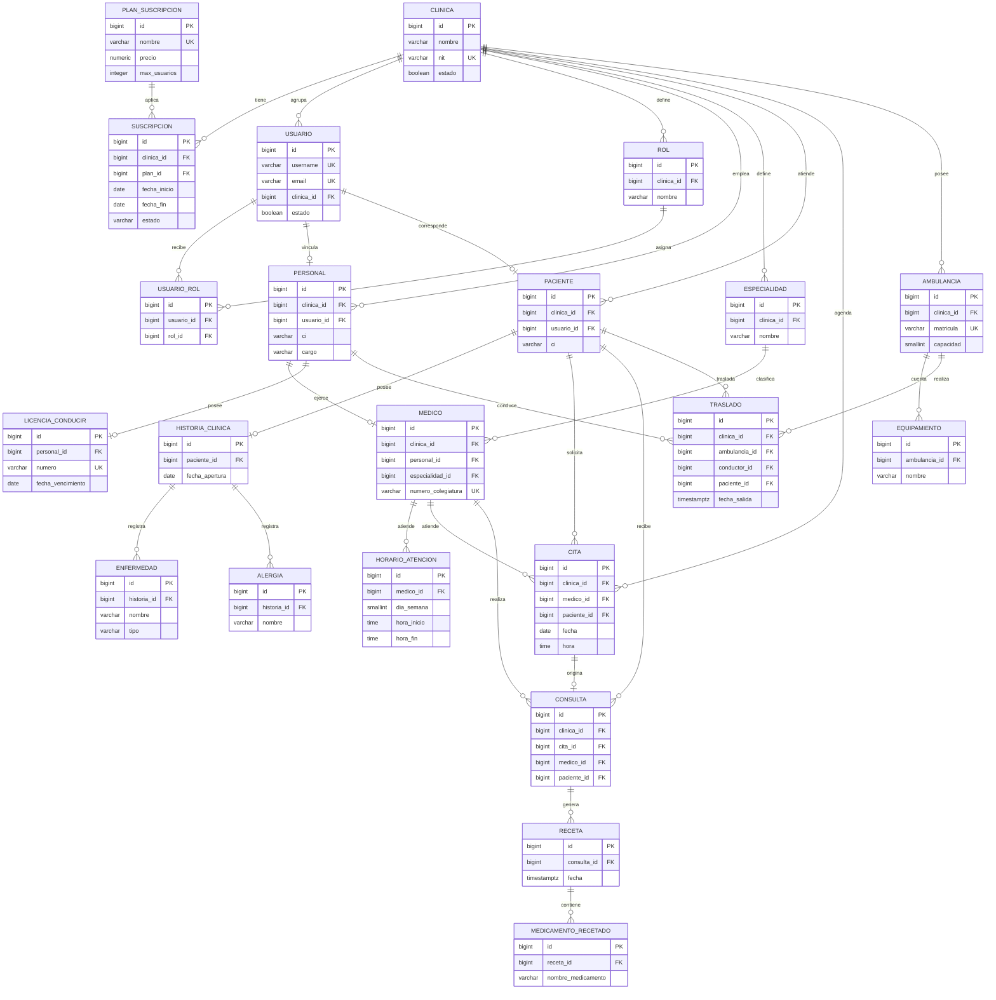

# Modelo físico de la base de datos

**Sprint 0 · PostgreSQL 17 · Django 5.2**

Convenciones:

- Motor: PostgreSQL, base de datos y esquema compartidos.
- PK: `id` `bigint` autogenerado (`BigAutoField`) salvo indicación contraria.
- Fechas: `date`; marcas de tiempo: `timestamptz` (Django `USE_TZ=True`).
- `clinica_id` es `bigint NOT NULL` en entidades raíz; las hijas no lo duplican.
- Los borrados usan `PROTECT` para datos clínicos, `CASCADE` para composiciones y
  `SET_NULL` para vínculos opcionales con usuarios.
- Los nombres de tabla siguen el formato `<app>_<modelo>`.

## 1. App `clinicas`

### `clinicas_clinica`

| Columna | Tipo | Restricciones |
|---|---|---|
| id | bigint | PK |
| nombre | varchar(150) | NOT NULL |
| direccion | varchar(255) | NOT NULL |
| telefono | varchar(30) | NOT NULL |
| email | varchar(254) | NOT NULL |
| nit | varchar(20) | NOT NULL, UNIQUE |
| estado | boolean | NOT NULL, default `true` |

Índices: `clinica_nombre_idx (nombre)`, `clinica_estado_idx (estado)`.

### `clinicas_plansuscripcion`

| Columna | Tipo | Restricciones |
|---|---|---|
| id | bigint | PK |
| nombre | varchar(80) | NOT NULL, UNIQUE |
| precio | numeric(10,2) | NOT NULL, `CHECK (precio >= 0)` |
| max_usuarios | integer | NOT NULL, `CHECK (max_usuarios > 0)` |
| descripcion | text | NOT NULL, default `''` |
| activo | boolean | NOT NULL, default `true` |

Índices: `plan_activo_idx (activo)`.

### `clinicas_suscripcion`

| Columna | Tipo | Restricciones |
|---|---|---|
| id | bigint | PK |
| clinica_id | bigint | FK → `clinicas_clinica(id)`, `PROTECT`, NOT NULL |
| plan_id | bigint | FK → `clinicas_plansuscripcion(id)`, `PROTECT`, NOT NULL |
| fecha_inicio | date | NOT NULL |
| fecha_fin | date | NOT NULL, `CHECK (fecha_fin >= fecha_inicio)` |
| estado | varchar(20) | NOT NULL, default `ACTIVA` |

Restricciones: `uniq_susc_activa_clinica` → UNIQUE parcial `(clinica_id)` cuando
`estado = 'ACTIVA'`.
Índices: `susc_clinica_estado_idx (clinica_id, estado)`,
`susc_clinica_fecha_fin_idx (clinica_id, fecha_fin)`.

## 2. App `seguridad`

### `seguridad_usuario`

| Columna | Tipo | Restricciones |
|---|---|---|
| id | bigint | PK |
| password | varchar(128) | NOT NULL (hash Django) |
| last_login | timestamptz | NULL |
| is_superuser | boolean | NOT NULL |
| username | varchar(150) | NOT NULL, UNIQUE |
| email | varchar(254) | NOT NULL, UNIQUE |
| fecha_creacion | timestamptz | NOT NULL, auto |
| estado | boolean | NOT NULL, default `true` |
| clinica_id | bigint | FK → `clinicas_clinica(id)`, `PROTECT`, NULL |
| is_staff | boolean | NOT NULL, default `false` |

Restricción: `usuario_clinica_o_superuser` → `CHECK (is_superuser OR clinica_id IS NOT NULL)`.
Tablas M2M de permisos: `seguridad_usuario_groups`, `seguridad_usuario_user_permissions`.
Índices: `usuario_clinica_idx (clinica_id)`, `usuario_estado_idx (estado)`.

### `seguridad_rol`

| Columna | Tipo | Restricciones |
|---|---|---|
| id | bigint | PK |
| clinica_id | bigint | FK → `clinicas_clinica(id)`, `PROTECT`, NOT NULL |
| nombre | varchar(80) | NOT NULL |
| descripcion | text | NOT NULL, default `''` |
| estado | boolean | NOT NULL, default `true` |

Restricción: `uniq_rol_por_clinica` → UNIQUE `(clinica_id, nombre)`.
Índices: `rol_clinica_estado_idx (clinica_id, estado)`.

### `seguridad_usuariorol`

| Columna | Tipo | Restricciones |
|---|---|---|
| id | bigint | PK |
| usuario_id | bigint | FK → `seguridad_usuario(id)`, `CASCADE`, NOT NULL |
| rol_id | bigint | FK → `seguridad_rol(id)`, `PROTECT`, NOT NULL |
| fecha_asignacion | timestamptz | NOT NULL, auto |

Restricción: `uniq_usuario_rol` → UNIQUE `(usuario_id, rol_id)`.
Índices: `usuario_rol_rol_idx (rol_id)`.
Validación de aplicación: usuario y rol deben pertenecer a la misma clínica.

## 3. App `personal`

### `personal_personal`

| Columna | Tipo | Restricciones |
|---|---|---|
| id | bigint | PK |
| clinica_id | bigint | FK → `clinicas_clinica(id)`, `PROTECT`, NOT NULL |
| usuario_id | bigint | FK → `seguridad_usuario(id)`, `SET_NULL`, UNIQUE, NULL |
| ci | varchar(20) | NOT NULL |
| nombre | varchar(100) | NOT NULL |
| apellido | varchar(100) | NOT NULL |
| telefono | varchar(30) | NOT NULL |
| cargo | varchar(80) | NOT NULL, default `OTRO` |
| fecha_ingreso | date | NOT NULL |
| estado | boolean | NOT NULL, default `true` |

Restricción: `uniq_personal_ci_clinica` → UNIQUE `(clinica_id, ci)`.
Índices: `personal_clinica_nombre_idx (clinica_id, apellido, nombre)`,
`personal_clinica_cargo_idx (clinica_id, cargo)`,
`personal_clinica_estado_idx (clinica_id, estado)`.

### `personal_especialidad`

| Columna | Tipo | Restricciones |
|---|---|---|
| id | bigint | PK |
| clinica_id | bigint | FK → `clinicas_clinica(id)`, `PROTECT`, NOT NULL |
| nombre | varchar(100) | NOT NULL |
| descripcion | text | NOT NULL, default `''` |
| estado | boolean | NOT NULL, default `true` |

Restricción: `uniq_especialidad_clinica` → UNIQUE `(clinica_id, nombre)`.
Índices: `especialidad_clinica_idx (clinica_id, estado)`.

### `personal_medico`

| Columna | Tipo | Restricciones |
|---|---|---|
| id | bigint | PK |
| clinica_id | bigint | FK → `clinicas_clinica(id)`, `PROTECT`, NOT NULL |
| personal_id | bigint | FK → `personal_personal(id)`, `CASCADE`, UNIQUE, NOT NULL |
| especialidad_id | bigint | FK → `personal_especialidad(id)`, `PROTECT`, NOT NULL |
| numero_colegiatura | varchar(30) | NOT NULL, UNIQUE |
| estado | boolean | NOT NULL, default `true` |

Índices: `medico_clinica_estado_idx (clinica_id, estado)`,
`medico_especialidad_idx (especialidad_id)`.

### `personal_horarioatencion`

| Columna | Tipo | Restricciones |
|---|---|---|
| id | bigint | PK |
| medico_id | bigint | FK → `personal_medico(id)`, `CASCADE`, NOT NULL |
| dia_semana | smallint | NOT NULL, `CHECK (dia_semana >= 0)` |
| hora_inicio | time | NOT NULL |
| hora_fin | time | NOT NULL, `CHECK (hora_inicio < hora_fin)` |

Restricción: `uniq_horario_exacto` → UNIQUE `(medico_id, dia_semana, hora_inicio, hora_fin)`.
Índices: `horario_medico_dia_idx (medico_id, dia_semana)`.

## 4. App `pacientes`

### `pacientes_paciente`

| Columna | Tipo | Restricciones |
|---|---|---|
| id | bigint | PK |
| clinica_id | bigint | FK → `clinicas_clinica(id)`, `PROTECT`, NOT NULL |
| usuario_id | bigint | FK → `seguridad_usuario(id)`, `SET_NULL`, UNIQUE, NULL |
| ci | varchar(20) | NOT NULL |
| nombre | varchar(100) | NOT NULL |
| apellido | varchar(100) | NOT NULL |
| sexo | varchar(10) | NOT NULL |
| fecha_nacimiento | date | NOT NULL |
| telefono | varchar(30) | NOT NULL |
| email | varchar(254) | NOT NULL, default `''` |
| estado | boolean | NOT NULL, default `true` |

Restricción: `uniq_paciente_ci_clinica` → UNIQUE `(clinica_id, ci)`.
Índices: `paciente_clinica_nombre_idx (clinica_id, apellido, nombre)`,
`paciente_fecha_nac_idx (fecha_nacimiento)`,
`paciente_clinica_estado_idx (clinica_id, estado)`.

### `pacientes_historiaclinica`

| Columna | Tipo | Restricciones |
|---|---|---|
| id | bigint | PK |
| paciente_id | bigint | FK → `pacientes_paciente(id)`, `PROTECT`, UNIQUE, NOT NULL |
| fecha_apertura | date | NOT NULL |
| grupo_sanguineo | varchar(4) | NOT NULL, default `DESC` |
| observaciones_generales | text | NOT NULL, default `''` |
| estado | boolean | NOT NULL, default `true` |
| fecha_ultima_actualizacion | timestamptz | NOT NULL, auto |

Índices: `historia_fecha_apertura_idx (fecha_apertura)`.

### `pacientes_enfermedad`

| Columna | Tipo | Restricciones |
|---|---|---|
| id | bigint | PK |
| historia_id | bigint | FK → `pacientes_historiaclinica(id)`, `CASCADE`, NOT NULL |
| nombre | varchar(150) | NOT NULL |
| tipo | varchar(30) | NOT NULL, default `OTRA` |
| severidad | varchar(20) | NOT NULL, default `LEVE` |
| fecha_deteccion | date | NOT NULL |

Índices: `enfermedad_hist_fecha_idx (historia_id, fecha_deteccion)`,
`enfermedad_nombre_idx (nombre)`.

### `pacientes_alergia`

| Columna | Tipo | Restricciones |
|---|---|---|
| id | bigint | PK |
| historia_id | bigint | FK → `pacientes_historiaclinica(id)`, `CASCADE`, NOT NULL |
| nombre | varchar(150) | NOT NULL |
| tipo | varchar(30) | NOT NULL, default `OTRA` |
| severidad | varchar(20) | NOT NULL, default `LEVE` |
| descripcion | text | NOT NULL, default `''` |

Restricción: `uniq_alergia_por_historia` → UNIQUE `(historia_id, nombre)`.

## 5. App `atencion`

### `atencion_cita`

| Columna | Tipo | Restricciones |
|---|---|---|
| id | bigint | PK |
| clinica_id | bigint | FK → `clinicas_clinica(id)`, `PROTECT`, NOT NULL |
| medico_id | bigint | FK → `personal_medico(id)`, `PROTECT`, NOT NULL |
| paciente_id | bigint | FK → `pacientes_paciente(id)`, `PROTECT`, NOT NULL |
| fecha | date | NOT NULL |
| hora | time | NOT NULL |
| estado | varchar(20) | NOT NULL, default `PROGRAMADA` |
| motivo | varchar(255) | NOT NULL |

Restricciones parciales (estado distinto de `CANCELADA`/`NO_ASISTIO`):
`uniq_cita_medico_activa` → UNIQUE `(medico_id, fecha, hora)`;
`uniq_cita_paciente_activa` → UNIQUE `(paciente_id, fecha, hora)`.
Índices: `cita_clinica_fecha_idx (clinica_id, fecha)`,
`cita_medico_fecha_idx (medico_id, fecha)`,
`cita_paciente_fecha_idx (paciente_id, fecha)`, `cita_estado_idx (estado)`.

### `atencion_consulta`

| Columna | Tipo | Restricciones |
|---|---|---|
| id | bigint | PK |
| clinica_id | bigint | FK → `clinicas_clinica(id)`, `PROTECT`, NOT NULL |
| cita_id | bigint | FK → `atencion_cita(id)`, `PROTECT`, UNIQUE, NULL |
| medico_id | bigint | FK → `personal_medico(id)`, `PROTECT`, NOT NULL |
| paciente_id | bigint | FK → `pacientes_paciente(id)`, `PROTECT`, NOT NULL |
| fecha | timestamptz | NOT NULL |
| motivo | text | NOT NULL |
| observacion | text | NOT NULL |
| diagnostico | text | NOT NULL |

Índices: `consulta_clinica_fecha_idx (clinica_id, fecha)`,
`consulta_medico_fecha_idx (medico_id, fecha)`,
`consulta_paciente_fecha_idx (paciente_id, fecha)`.

### `atencion_receta`

| Columna | Tipo | Restricciones |
|---|---|---|
| id | bigint | PK |
| consulta_id | bigint | FK → `atencion_consulta(id)`, `PROTECT`, NOT NULL |
| fecha | timestamptz | NOT NULL |
| indicaciones | text | NOT NULL, default `''` |

Índices: `receta_consulta_fecha_idx (consulta_id, fecha)`.

### `atencion_medicamentorecetado`

| Columna | Tipo | Restricciones |
|---|---|---|
| id | bigint | PK |
| receta_id | bigint | FK → `atencion_receta(id)`, `CASCADE`, NOT NULL |
| nombre_medicamento | varchar(150) | NOT NULL |
| dosis | varchar(50) | NOT NULL |
| frecuencia | varchar(50) | NOT NULL |
| duracion | varchar(50) | NOT NULL |

Índices: `medicamento_receta_idx (receta_id)`.

## 6. App `ambulancias`

### `ambulancias_ambulancia`

| Columna | Tipo | Restricciones |
|---|---|---|
| id | bigint | PK |
| clinica_id | bigint | FK → `clinicas_clinica(id)`, `PROTECT`, NOT NULL |
| matricula | varchar(20) | NOT NULL, UNIQUE |
| tipo | varchar(30) | NOT NULL, default `BASICA` |
| estado | varchar(20) | NOT NULL, default `DISPONIBLE` |
| capacidad | smallint | NOT NULL, `CHECK (capacidad > 0)` |

Índices: `ambulancia_clinica_estado_idx (clinica_id, estado)`.

### `ambulancias_equipamiento`

| Columna | Tipo | Restricciones |
|---|---|---|
| id | bigint | PK |
| ambulancia_id | bigint | FK → `ambulancias_ambulancia(id)`, `CASCADE`, NOT NULL |
| nombre | varchar(100) | NOT NULL |
| descripcion | text | NOT NULL, default `''` |

Restricción: `uniq_equipamiento_ambulancia` → UNIQUE `(ambulancia_id, nombre)`.

### `ambulancias_licenciaconducir`

| Columna | Tipo | Restricciones |
|---|---|---|
| id | bigint | PK |
| personal_id | bigint | FK → `personal_personal(id)`, `CASCADE`, UNIQUE, NOT NULL |
| numero | varchar(30) | NOT NULL, UNIQUE |
| categoria | varchar(10) | NOT NULL |
| fecha_emision | date | NOT NULL |
| fecha_vencimiento | date | NOT NULL, `CHECK (fecha_vencimiento > fecha_emision)` |

Índices: `licencia_vencimiento_idx (fecha_vencimiento)`.

### `ambulancias_traslado`

| Columna | Tipo | Restricciones |
|---|---|---|
| id | bigint | PK |
| clinica_id | bigint | FK → `clinicas_clinica(id)`, `PROTECT`, NOT NULL |
| ambulancia_id | bigint | FK → `ambulancias_ambulancia(id)`, `PROTECT`, NOT NULL |
| conductor_id | bigint | FK → `personal_personal(id)`, `PROTECT`, NOT NULL |
| paciente_id | bigint | FK → `pacientes_paciente(id)`, `PROTECT`, NOT NULL |
| motivo | varchar(255) | NOT NULL |
| fecha_salida | timestamptz | NOT NULL |
| fecha_llegada | timestamptz | NULL |
| tipo_traslado | varchar(30) | NOT NULL, default `PROGRAMADO` |
| estado | varchar(20) | NOT NULL, default `PROGRAMADO` |
| observacion | text | NOT NULL, default `''` |
| lugar_origen | varchar(255) | NOT NULL |
| lugar_destino | varchar(255) | NOT NULL |

Restricción: `traslado_fechas_validas` →
`CHECK (fecha_llegada IS NULL OR fecha_llegada >= fecha_salida)`.
Índices: `traslado_clinica_fecha_idx (clinica_id, fecha_salida)`,
`traslado_ambulancia_fecha_idx (ambulancia_id, fecha_salida)`,
`traslado_conductor_fecha_idx (conductor_id, fecha_salida)`,
`traslado_paciente_fecha_idx (paciente_id, fecha_salida)`,
`traslado_estado_idx (estado)`.

## 7. Diagrama ER

## 8. Resumen de aislamiento por tabla

| Tabla | `clinica_id` directa | Ruta `tenant_lookup` |
|---|---|---|
| `clinicas_suscripcion` | Sí | — |
| `seguridad_usuario` | Sí (nullable solo superusuario) | — |
| `seguridad_rol` | Sí | — |
| `seguridad_usuariorol` | No | `usuario__clinica` |
| `personal_personal` | Sí | — |
| `personal_especialidad` | Sí | — |
| `personal_medico` | Sí | — |
| `personal_horarioatencion` | No | `medico__clinica` |
| `pacientes_paciente` | Sí | — |
| `pacientes_historiaclinica` | No | `paciente__clinica` |
| `pacientes_enfermedad` | No | `historia__paciente__clinica` |
| `pacientes_alergia` | No | `historia__paciente__clinica` |
| `atencion_cita` | Sí | — |
| `atencion_consulta` | Sí | — |
| `atencion_receta` | No | `consulta__clinica` |
| `atencion_medicamentorecetado` | No | `receta__consulta__clinica` |
| `ambulancias_ambulancia` | Sí | — |
| `ambulancias_equipamiento` | No | `ambulancia__clinica` |
| `ambulancias_licenciaconducir` | No | `personal__clinica` |
| `ambulancias_traslado` | Sí | — |
